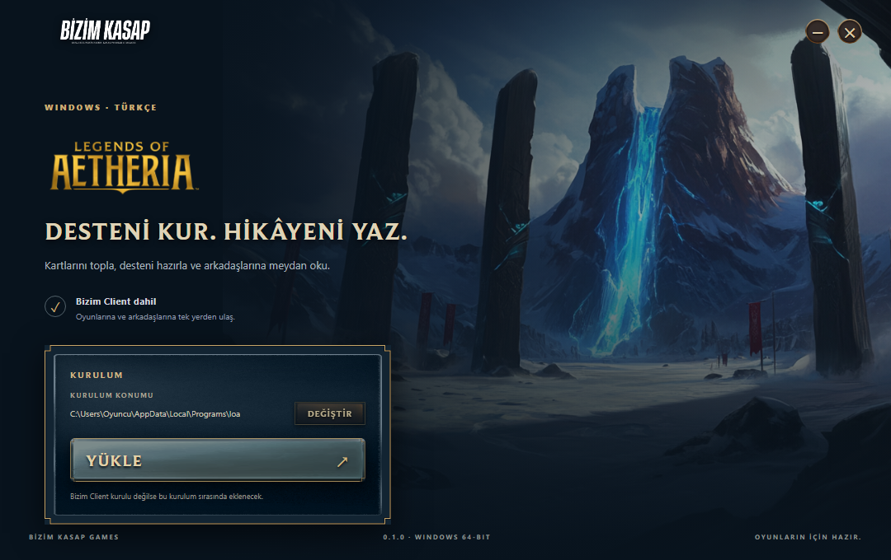

# Legends of Aetheria

Windows için arkadaş karşılaşmaları içeren ilk dağıtım sürümü: **0.1.0**.

**[Legends of Aetheria'yı indir](https://github.com/ATOStudios/loa/releases/latest/download/Legends-of-Aetheria-Setup.exe)** · [Son sürüm](https://github.com/ATOStudios/loa/releases/latest)

Windows 10/11, 64 bit. Kurulum internet bağlantısı gerektirir.

Kurulum dosyası gerekli uygulamaları GitHub üzerinden indirir, dosyaları doğrular ve masaüstü / Başlat menüsü kısayollarını oluşturur. Yarım kalan indirmeler tekrar çalıştırıldığında devam edebilir.

Kurulumlar şu anda yayıncı sertifikasıyla imzalı değildir; Windows yayıncıyı doğrulayamayabilir.

**Bizim Client bu kurulumla birlikte hazırlanır.** Ayrı bir indirme aramana gerek yok. Oyun Bizim Client üzerinden açılır; önce Discord hesabınla giriş yapmalısın. Mevcut hesap erişimi Kasap Discord topluluğu üyeliği gerektirir.

Arkadaşınla oynamak için:

1. İkiniz de aynı güncel LoA sürümünü Bizim Client üzerinden açın.
2. Sosyal menüsünde arkadaş olun; **Meydan Oku** ile davet gönderin.
3. Daveti kabul edip destelerinizi seçin ve hazır olun.
4. Karşılaşma iki tarafın yüklemesi tamamlandıktan sonra başlar.

Bu sürümde rastgele eşleşme bulunmaz. Gerçek para ile satın alma arkadaş testi sürümünde kapalıdır.

[Bizim Client](https://github.com/ATOStudios/BizimClient) · [Universe of DnD 2](https://github.com/ATOStudios/uod2)
